<p>
  <a href="https://github.com/HBAI-Ltd/Toonflow-app">
    
  </a>
  &nbsp;|&nbsp;
  <a href="https://gitee.com/HBAI-Ltd/Toonflow-app">
    
  </a>
  &nbsp;|&nbsp;
  <a href="https://gitcode.com/HBAI-Ltd/Toonflow-app">
    
  </a>
</p>

<p align="center">
  <a href="../README.md">简体中文</a> |
  <strong>繁体中文</strong> |
  <a href="./README.en.md">English</a> |
  <a href="./README.th.md">ไทย</a> |
  <a href="./README.vi.md">Tiếng Việt</a> |
  <a href="./README.ja.md">日本语</a> |
  <a href="./README.ru.md">Русский</a>
</p>

<div align="center">
  <p align="center">
    
  </p>

  <p align="center">
    <a href="https://git.io/typing-svg" target="_blank">
      <picture>
        <source media="(prefers-color-scheme: dark)" srcset="https://readme-typing-svg.demolab.com?font=Fira+Code&size=40&duration=3000&pause=1000&color=FFFFFF&center=true&vCenter=true&width=600&lines=Toonflow;AI%E7%9F%AD%E5%89%A7%E5%B7%A5%E5%8E%82;%E5%8A%A8%E5%8A%A8%E6%89%8B%E6%8C%87%EF%BC%8C%E5%B0%8F%E8%AF%B4%E7%A7%92%E5%8F%98%E5%89%A7%E9%9B%86%EF%BC%81" />
        
      </picture>
    </a>
  </p>

  <p align="center">
    <a href="https://github.com/HBAI-Ltd/Toonflow-app/stargazers">
      
    </a>
    <a href="https://www.apache.org/licenses/LICENSE-2.0" target="_blank">
      
    </a>
    <a href="https://github.com/HBAI-Ltd/Toonflow-app/releases">
      
    </a>
  </p>
  <p align="center">
    <a href="https://github.com/HBAI-Ltd/Toonflow-app/network/members">
      
    </a>
    <a href="https://atomgit.com/HBAI-Ltd/Toonflow-app">
      
    </a>
    <a href="https://discord.gg/HEjKmpNpAZ">
      
    </a>
  </p>
  <p align="center">
    <a href="https://github.com/HBAI-Ltd/Toonflow-app/issues">
      
    </a>
    <a href="https://github.com/HBAI-Ltd/Toonflow-app/graphs/contributors">
      
    </a>
    <a href="https://github.com/HBAI-Ltd/Toonflow-app/commits">
      
    </a>
  </p>
  <p align="center">
    &nbsp;
    &nbsp;
    &nbsp;
    
  </p>

  > 🚀 **一站式短剧工程**：从文本到角色，从分镜到影片，0门槛全流程AI化，创作效率提升10倍+！
</div>

<div align="center">
  <table>
    <tr>
      <td width="50%" align="center">
        <a href="./g-star.png" target="_blank">
          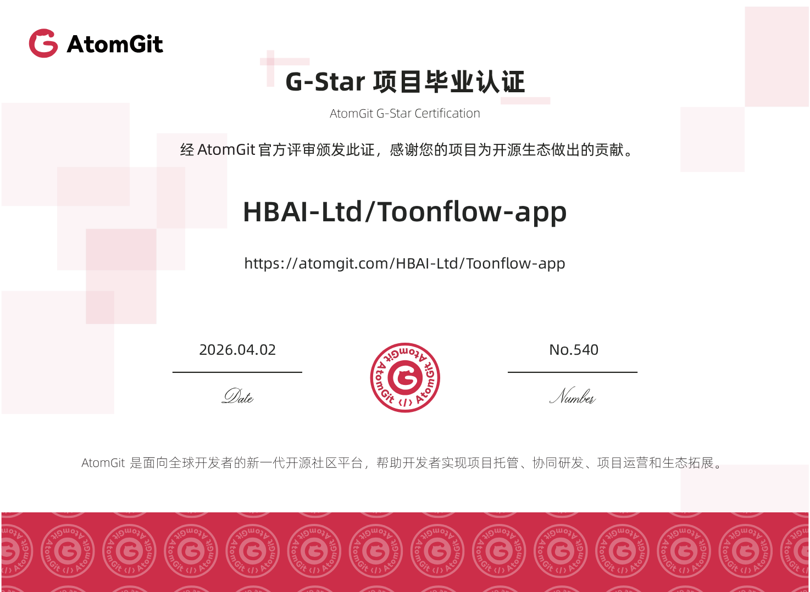
        </a>
      </td>
      <td width="50%" align="center">
        <a href="./gvp.jpg" target="_blank">
          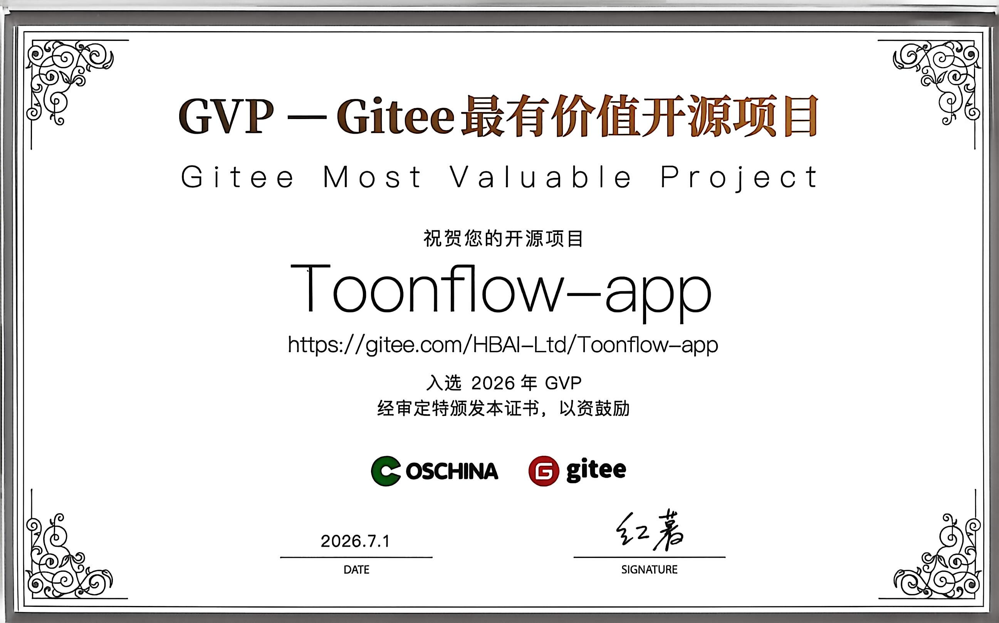
        </a>
      </td>
    </tr>
  </table>
</div>

---

# 🌐 多语言支援

Toonflow 支援以下语言介面：

| 语言       | Language              |
| ---------- | --------------------- |
| 简体中文   | Chinese (Simplified)  |
| 繁体中文   | Chinese (Traditional) |
| English    | English               |
| ไทย        | Thai                  |
| Tiếng Việt | Vietnamese            |
| 日本语     | Japanese              |
| Русский    | Russian               |

> 💡 更多语言适配中，欢迎贡献翻译！

---

# 🌟 主要功能

Toonflow 是面向短剧生产的 AI 工作台，围绕「策划 → 编剧 → 分镜 → 出片」构建完整闭环，并支援本地化、可程式化、可持续迭代的生产流程。

- ✅ **无限画布生产工作台**
  以类无限画布形式组织剧本、角色、分镜、素材与影片节点，支援自由编排、回溯与并行生产，不受线性步骤限制。
- ✅ **三层 Agent 协作体系**
  决策层、执行层、监督层协同工作，涵盖任务拆解、内容生成、品质审阅与修订反馈，提升稳定性与成片一致性。
- ✅ **持久化 Agent 记忆**
  基于本地 ONNX 向量检索的跨会话记忆系统，支援短期讯息、长期摘要和语义召回，确保多轮创作连续性。
- ✅ **可程式化供应商系统**
  支援在设定中心直接编写供应商 TypeScript 逻辑并即时生效，无需改源码或重启，便于私有化和多模型接入。
- ✅ **章节事件图谱驱动改编**
  自动提取原著章节事件并结构化储存，剧本改编按事件图谱精准呼叫上下文，减少长文本资讯遗失。
- ✅ **Skill 档案化配置**
  ScriptAgent 与 ProductionAgent 的核心提示词外化为 Markdown Skill 档案，支援线上编辑与快速调优。

---

# 📦 应用场景

- 短视频内容创作
- 小说影视化实验
- AI 文学改编工具
- 剧本开发与快速原型
- 影片素材生成

---

# 🔰 使用指南

## 快速上手

1. 启动应用并登入（预设帐号：`admin` / `admin123`）。
2. 在设定中心完成模型供应商配置（文字/图像/影片模型）。
3. 新建专案并汇入原著，执行章节事件提取。
4. 进入 ScriptAgent 生成故事骨架、改编策略与结构化剧本。
5. 切换到 ProductionAgent，在无限画布中组织分镜、素材与影片节点。
6. 对分镜图进行节点化精调后回流工作台，完成影片拼接与汇出。

## 📺 影片教学

https://www.bilibili.com/video/BV1oXD7BqEqJ
[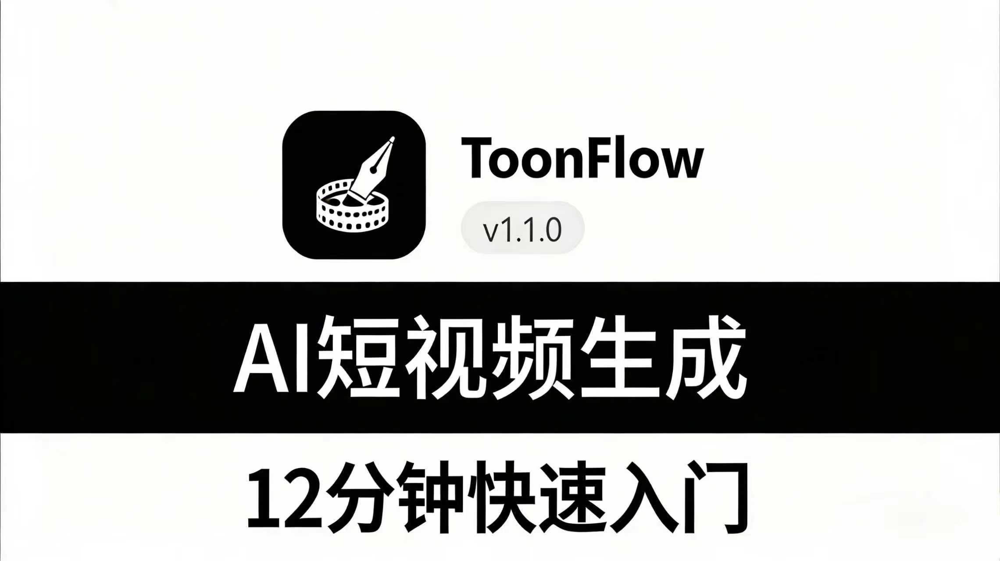](https://www.bilibili.com/video/BV1oXD7BqEqJ)

**Toonflow 12 分钟快速上手 AI 影片**
👉 [点击观看](https://www.bilibili.com/video/BV1oXD7BqEqJ)

📱 手机微信扫码观看


---

# 📸 示范截图与影片

以下截图及影片来自使用 Toonflow 制作的一段 AI 短剧 Demo，全程约 2 小时完成，涵盖剧本生成、分镜制作及剪辑环节。

<div align="center">
<table>
  <tr>
    <td width="50%"><a href="./screenshot/1.png" target="_blank">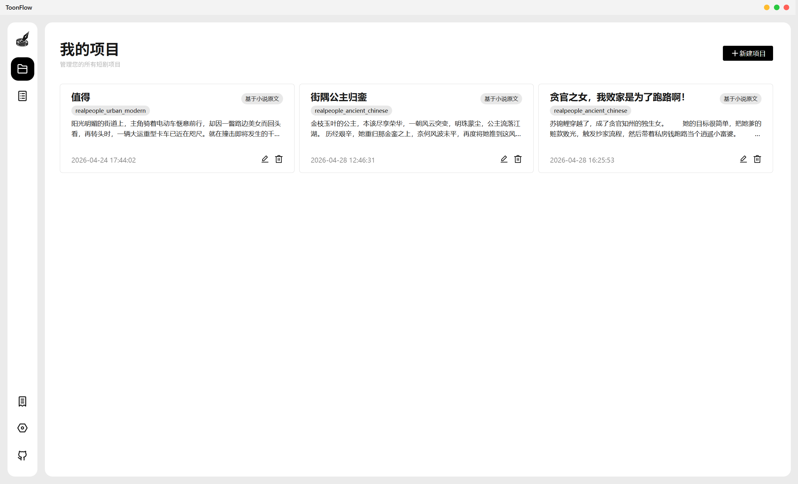</a></td>
    <td width="50%"><a href="./screenshot/2.png" target="_blank">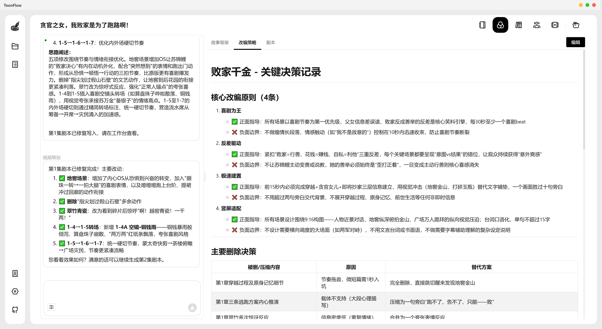</a></td>
  </tr>
  <tr>
    <td width="50%"><a href="./screenshot/3.png" target="_blank">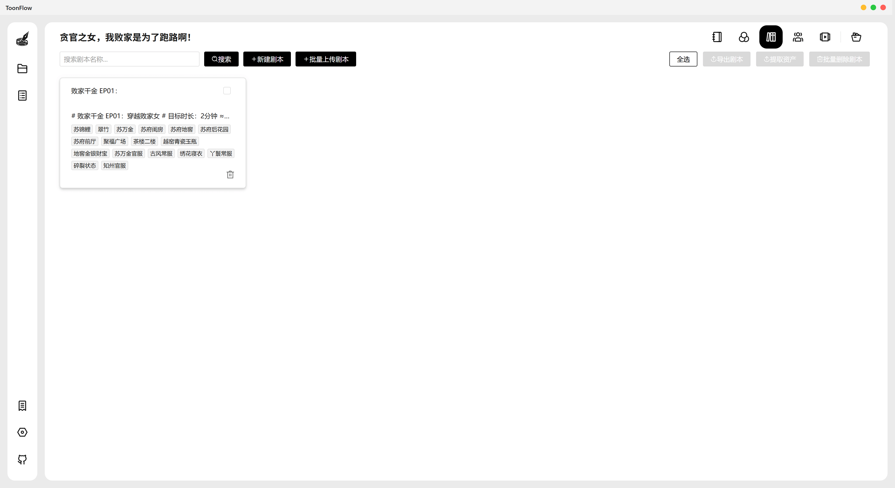</a></td>
    <td width="50%"><a href="./screenshot/4.png" target="_blank">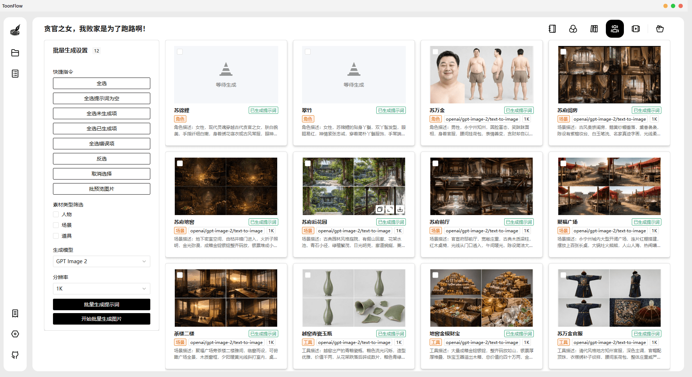</a></td>
  </tr>
  <tr>
    <td width="50%"><a href="./screenshot/5.png" target="_blank">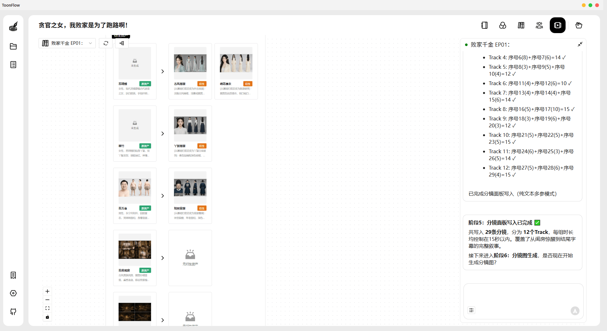</a></td>
    <td width="50%"><a href="./screenshot/6.png" target="_blank">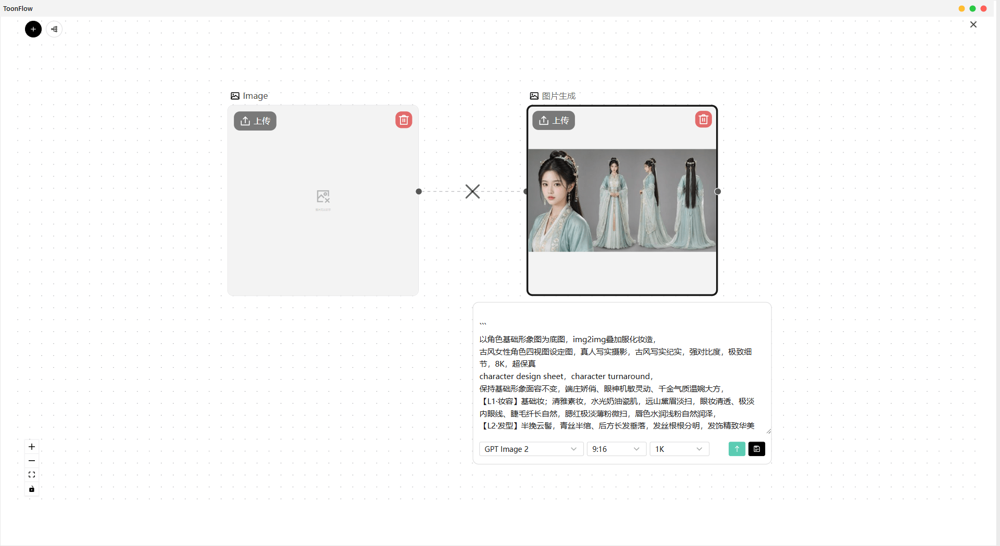</a></td>
  </tr>
  <tr>
    <td width="50%"><a href="./screenshot/7.png" target="_blank">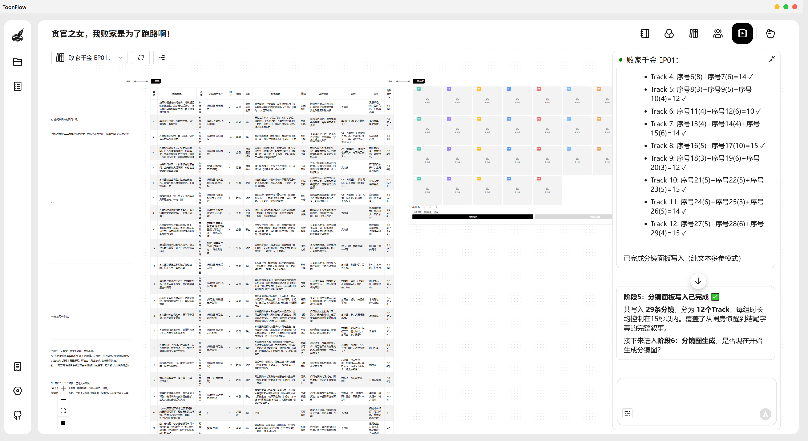</a></td>
    <td width="50%"><a href="./screenshot/8.png" target="_blank">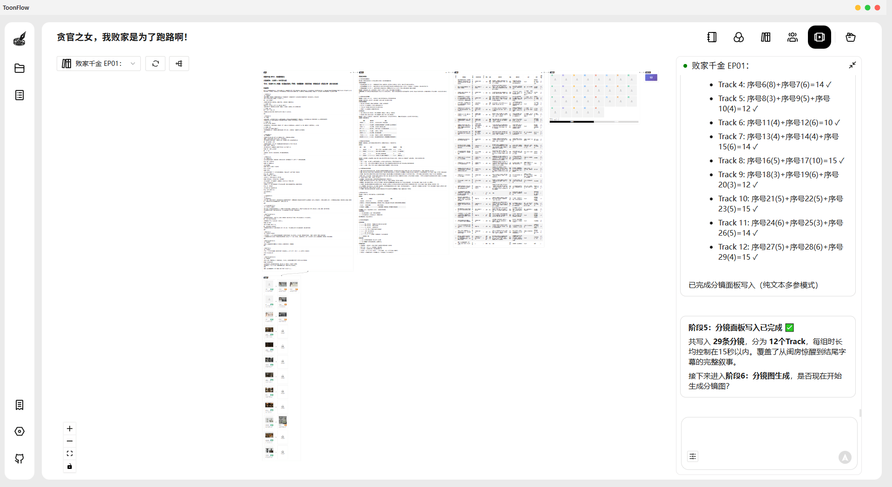</a></td>
  </tr>
  <tr>
    <td width="50%"><a href="./screenshot/9.png" target="_blank">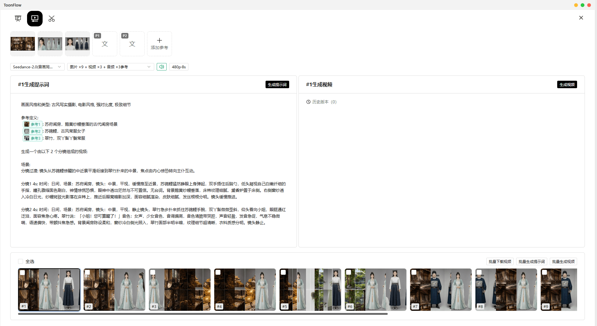</a></td>
    <td width="50%"><a href="./screenshot/10.png" target="_blank">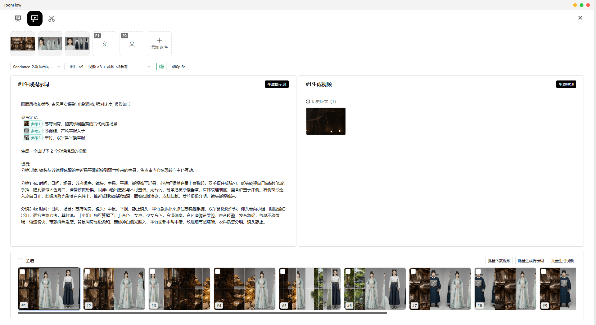</a></td>
  </tr>
</table>
</div>

## 🎬 Demo 影片

<div align="center">

https://github.com/user-attachments/assets/2d9fddac-dfdf-4640-b030-b09d7f7287e9

如无法播放，请[点击下载影片](./screenshot/demo.mp4)

</div>

## Demo 资讯

| 项目 | 详情 |
| :--- | :--- |
| 制作周期 | 约 2 小时 |
| 影片模型 | Seedance 2.0 |
| 图片模型 | GPT Image 2 |
| 语言模型 | Claude Opus 4.6 |
| 成片总时长 | 约 2 分钟（原始素材 3 分钟，剪除废片约 1 分钟） |

## 成本明细

| 模型类型 | 费用 |
| :--- | :--- |
| 语言模型 | 约 ¥10 |
| 影片模型（全量生成） | 约 ¥120 |
| 图片模型 | 不足 ¥1 |
| **合计** | **约 ¥130** |

> **声明**：Demo 原始解析度为 1080×1882，发布版本已压缩至 480p。如涉及版权问题，请联系我们删除处理。

---

# 🚀 安装

## 前置条件

在安装和使用本软体之前，请准备以下内容：

- ✅ 大语言模型 AI 服务介面地址
- ✅ Sora 或豆包影片服务介面地址
- ✅ Nano Banana Pro 图片生成模型服务介面

## 本机安装

### 1. 下载与安装

| 作业系统 | GitHub                                                       | 说明           |
| :------: | :----------------------------------------------------------- | :------------- |
| Windows  | [Release](https://github.com/HBAI-Ltd/Toonflow-app/releases) | 官方发布安装包 |
|  Linux   | [Release](https://github.com/HBAI-Ltd/Toonflow-app/releases) | 官方发布安装包 |
|  macOS   | [Release](https://github.com/HBAI-Ltd/Toonflow-app/releases) | 官方发布安装包 |

> [!CAUTION]
> MacOS 系统请到 设定-隐私与安全性 配置安全性否则可能因凭证问题无法正常开启
>
> 参考知乎文件：[https://www.zhihu.com/question/433389276](https://www.zhihu.com/question/433389276)

> 因 Gitee OS 环境限制及 Release 档案上传大小限制，暂不提供 Gitee Release 下载地址。

### 2. 启动服务

安装完成后，启动程式即可开始使用本服务。

> ⚠️ **首次登入**
> 帐号：`admin`
> 密码：`admin123`

## Docker 部署

### 前置条件

- 已安装 [Docker](https://docs.docker.com/get-docker/)（版本 20.10+）

### 方式一：线上部署

待完善，暂时使用本地建置。

### 方式二：本地建置

使用本地已有的原始码直接建置，适合开发者或已克隆仓库的使用者，这需要你在本地安装 git：

```shell
# 先克隆专案（如已有则跳过）
git clone https://github.com/HBAI-Ltd/Toonflow-app.git
cd Toonflow-app

# 使用 docker-compose 本地建置并启动
yarn docker:local

# 或者手动建置
docker build -t toonflow .
docker run -d -p <本地埠>:10588 -v <本地资料路径>:/app/data toonflow

# 此时在相应埠的 /index.html 路径即可访问页面
# 例如 http://localhost:10588/index.html
```

### 服务埠说明

| 埠      | 用途     | 部署映射      |
| ------- | -------- | ------------- |
| `10588` | 软体介面 | `10588:10588` |

**环境变数说明：**

| 变数       | 说明                               |
| ---------- | ---------------------------------- |
| `NODE_ENV` | 执行环境，`prod` 表示生产环境      |
| `PORT`     | 服务监听埠（预设 10588）           |
| `OSSURL`   | 档案储存访问位址，用于静态资源访问 |

---

## 云端部署

### 云伺服器部署

#### 一、伺服器环境要求

- **系统**：Ubuntu 20.04+ / CentOS 7+
- **Node.js**：24.x（推荐，最低 23.11.1+）
- **记忆体**：2GB+

#### 二、伺服器部署

##### 1. 安装环境

```bash
# 安装 Node.js
curl -o- https://raw.githubusercontent.com/nvm-sh/nvm/v0.39.7/install.sh | bash
source ~/.bashrc
nvm install 24
# 安装 Yarn 和 PM2
npm install -g yarn pm2
```

##### 2. 部署专案

**从 GitHub 克隆：**

```bash
cd /opt
git clone https://github.com/HBAI-Ltd/Toonflow-app.git
cd Toonflow-app
yarn install
yarn build
```

**从 Gitee 克隆（国内推荐）：**

```bash
cd /opt
git clone https://gitee.com/HBAI-Ltd/Toonflow-app.git
cd Toonflow-app
yarn install
yarn build
```

##### 3. 配置 PM2

建立 `pm2.json` 档案：

```json
{
  "name": "toonflow-app",
  "script": "data/serve/app.js",
  "instances": "max",
  "exec_mode": "cluster",
  "env": {
    "NODE_ENV": "prod",
    "PORT": 10588,
    "OSSURL": "http://127.0.0.1:10588/"
  }
}
```

**环境变数说明：**

| 变数       | 说明                               |
| ---------- | ---------------------------------- |
| `NODE_ENV` | 执行环境，`prod` 表示生产环境      |
| `PORT`     | 服务监听埠                         |
| `OSSURL`   | 档案储存访问位址，用于静态资源访问 |

---

##### 4. 启动服务

```bash
pm2 start pm2.json
pm2 startup
pm2 save
```

##### 5. 常用指令

```bash
pm2 list              # 查看进程
pm2 logs toonflow-app # 查看日志
pm2 restart all       # 重启服务
pm2 monit             # 监控面板
```

> ⚠️ **首次登入**
> 帐号：`admin`
> 密码：`admin123`

##### 6. 部署前端网站

如需单独部署或定制前端介面，请参考前端仓库：

- **GitHub**：[Toonflow-web](https://github.com/HBAI-Ltd/Toonflow-web)
- **Gitee**：[Toonflow-web](https://gitee.com/HBAI-Ltd/Toonflow-web)

> 💡 **说明**：本仓库已内建编译好的前端资源，一般使用者无需单独部署前端。前端仓库仅供需要二次开发的开发者使用。

### 云平台部署

> 🎉 **官方认证算力合作平台 —— 智星云**
>
> **[智星云](https://www.ai-galaxy.com/)** 是 **Toonflow 官方授权的商用镜像服务商**，已合法搭载、分发并支援商用全套 Toonflow AI 短剧制作镜像，**开箱即用，无需手动部署**。
>
> - 🌐 官网：[https://www.ai-galaxy.com](https://www.ai-galaxy.com)
> - 📖 镜像部署图文教程：[点击查看教程](https://mp.weixin.qq.com/s/lq9X1ovQ1_TKeXMOLgicKg?scene=1)

<details>
<summary>📄 点击展开文字版教程</summary>

#### 一、租用 GPU 阶段教程

1. 智星云 - 算力市场 - 4090 / 4090 Plus，点击「立即租用」进入租用详情页。
   > 💡 建议开启「按小时自动续租」模式，防止正在跑影片时实例到期停工。
2. 镜像选择：`windows10LTSCwin10_Toonflow` - 建立实例。
3. 等待实例启动 30s ~ 60s，查看连接方式 - RDP 登入档案下载 - 点击复制密码 - 双击已下载好的云端连接档案。
4. 将复制好的密码贴上并登入，连接进入云端桌面。
   > 💡 滑鼠移到云端桌面顶端稍作停留，会显示切换桌面操作栏，可点击「──」切换回自己的电脑桌面，或点击「□」缩小布置到自己的电脑桌面作为操作视窗。

#### 二、配置 Toonflow、启动 ComfyUI 阶段教程

1. 先配置调用 Agent 的模型：打开桌面上的 Toonflow - 模型服务 - OpenAI 标准介面 - 填入 API 金钥以及请求位址。
   预设帐号：`admin`　密码：`admin123`（建议登入后修改密码）
   > 💡 这里直接使用智星云的 AI 大模型 Token 服务，官方介面，稳定安全，低至 6 折（小说转剧本调用一次，约花费 6.4 毛钱）。
   - 智星云调用模型 Token 请求位址：`https://token.ai-galaxy.com/v1`
   - 智星云 Token 充值步骤：Token 市场 - 帐户概览 - 充值 - 将智星云帐户余额或算力券充值到 Token 帐户中。
   - 充值完成后进入「Key 管理」- 新建 API 管理，名称填 `Toonflow` 或其他均可，点击确定并复制 API 金钥。
2. 回到步骤 1，将生成的 API 金钥和请求位址贴上到 Toonflow 模型服务中，填好后点击空白处，系统会提示「供应商配置已更新」。
   点击「手动添加」，回到智星云 - Token 市场页面，复制完整的模型名称。
   > 💡 一个 Key 可以调用智星云上的所有模型，选择你想用的即可，推荐 `deepseek-v4-pro`。
   将模型名称完整复制贴上到 Toonflow 中并确认，完成模型配置。
3. 配置完成后检查两处：
   - 模型服务中的三个模型调用开关是否已开启
   - Agent 配置中调用的模型是否与你配置的一致（不一致时点击选择改正即可）
4. 启动 ComfyUI：云端桌面 - 绘世启动器 - 一键启动。
5. 启动大约需要 1~2 分钟，启动完成后保持页面开启状态即可。

</details>

---

# 🔧 开发流程指南

> [!CAUTION]
> 🚧 **PR 提交规范** 🚧
>
> ⛔ `master` 分支不接受任何 PR ｜ ✅ 请将 PR 提交到 `develop` 分支
>
> 欢迎开发者们共同参与 Toonflow 的共创。如有兴趣加入，请在交流群内联系主持人 ACT

## 🛠️ 技术栈

| 类别       | 技术                                                                                      |
| ---------- | ----------------------------------------------------------------------------------------- |
| 执行时     | Node.js 23.11.1+                                                                          |
| 语言       | TypeScript 5.x                                                                            |
| 后端框架   | Express 5                                                                                 |
| 资料库     | SQLite（better-sqlite3 / knex）                                                           |
| AI 整合    | Vercel AI SDK（OpenAI / Anthropic / Google / DeepSeek / 智谱 / MiniMax / 通义千问 / xAI） |
| 本地推理   | @huggingface/transformers（ONNX）                                                         |
| 即时通讯   | Socket.IO                                                                                 |
| 桌面客户端 | Electron 40                                                                               |
| 图像处理   | Sharp                                                                                     |
| 容器化     | Docker                                                                                    |

## 开发环境准备

- **Node.js**：版本要求 23.11.1 及以上
- **Yarn**：推荐作为专案套件管理器

## 快速启动专案

1. **克隆专案**

   **从 GitHub 克隆：**

   ```bash
   git clone https://github.com/HBAI-Ltd/Toonflow-app.git
   cd Toonflow-app
   ```

   **从 Gitee 克隆（国内推荐）：**

   ```bash
   git clone https://gitee.com/HBAI-Ltd/Toonflow-app.git
   cd Toonflow-app
   ```

2. **安装依赖**

   请先在专案根目录下执行以下指令以安装依赖项：

   ```bash
   yarn install
   ```

3. **启动开发环境**

   本专案包含 **后端 API 服务** 和 **前端页面** 两部分，请根据需要选择启动方式：

   - **方式一：仅启动后端服务**

     ```bash
     yarn dev
     ```

     > ⚠️ 此指令仅启动后端 API 服务（埠 10588），**不包含前端页面**。直接访问 `http://localhost:10588` 只能呼叫 API 介面，无法看到完整的网页介面。如需同时使用前端页面，请配合前端专案单独启动，或使用下方的 GUI 模式。

   - **方式二：启动 Electron 桌面客户端**

     ```bash
     yarn dev:gui
     ```

     > 此指令会同时启动后端服务和 Electron 桌面视窗，自带内建前端页面，开箱即用，无需额外配置。适合想要完整体验所有功能的开发者。

   - **方式三：生产模式启动**

     ```bash
     yarn start
     ```

     > 以生产模式直接执行编译后的服务（需先执行 `yarn build`）。

4. **专案打包**

   - 编译并生成 TypeScript 档案：

     ```bash
     yarn build
     ```

   - 打包为 Windows 平台可执行程式：

     ```bash
     yarn dist:win
     ```

   - 打包为 Mac 平台可执行程式：

     ```bash
     yarn dist:mac
     ```

   - 打包为 Linux 平台可执行程式：

     ```bash
     yarn dist:linux
     ```

5. **程式码品质检查**

   - 进行全域语法和规范检查：

     ```bash
     yarn lint
     ```

6. **AI 侦错面板（可选）**

   启动 AI SDK 的可视化侦错工具，方便侦错 AI 呼叫：

   ```bash
   yarn debug:ai
   ```

## 前端开发

如需修改前端介面，请前往前端仓库进行开发：

- **GitHub**：[Toonflow-web](https://github.com/HBAI-Ltd/Toonflow-web)
- **Gitee**：[Toonflow-web](https://gitee.com/HBAI-Ltd/Toonflow-web)

前端建置后，将 `dist` 目录内容复制到本专案的 `data/web` 目录即可整合。

## 专案结构

```
📂 build/                    # 编译产物
📂 data/                     # 执行时资料
│  ├─ 📂 models/            # 本地推理模型（ONNX）
│  ├─ 📂 oss/               # 物件储存（素材/角色/场景）
│  ├─ 📂 serve/             # 生产环境入口
│  ├─ 📂 skills/            # Agent 技能提示词
│  └─ 📂 web/               # 前端编译产物（内建）
📂 docs/                     # 文件资源
📂 env/                      # 环境配置
📂 scripts/                  # 建置与辅助脚本
📂 src/
├─ 📂 agents/               # AI Agent 模组
│  ├─ 📂 productionAgent/   # 生产 Agent
│  └─ 📂 scriptAgent/       # 剧本 Agent
├─ 📂 lib/                  # 公共库（资料库初始化、回应格式）
├─ 📂 middleware/            # 中介软体
├─ 📂 routes/               # 路由模组
│  ├─ 📂 agents/            # Agent 记忆管理
│  ├─ 📂 artStyle/          # 画风管理
│  ├─ 📂 assets/            # 素材管理
│  ├─ 📂 assetsGenerate/    # 素材生成
│  ├─ 📂 cornerScape/       # 分镜管理
│  ├─ 📂 general/           # 通用介面
│  ├─ 📂 login/             # 登入认证
│  ├─ 📂 migrate/           # 资料迁移
│  ├─ 📂 modelSelect/       # 模型选择
│  ├─ 📂 novel/             # 小说管理
│  ├─ 📂 other/             # 其他功能
│  ├─ 📂 production/        # 制作管理
│  ├─ 📂 project/           # 专案管理
│  ├─ 📂 script/            # 剧本生成
│  ├─ 📂 scriptAgent/       # 剧本 Agent 介面
│  ├─ 📂 setting/           # 系统设定
│  ├─ 📂 task/              # 任务管理
│  └─ 📂 test/              # 测试介面
├─ 📂 socket/               # WebSocket 即时通讯
├─ 📂 types/                # TypeScript 型别宣告
├─ 📂 utils/                # 工具函数
├─ 📄 app.ts                # 应用入口
├─ 📄 core.ts               # 核心初始化
├─ 📄 env.ts                # 环境变数处理
├─ 📄 err.ts                # 错误处理
├─ 📄 logger.ts             # 日志模组
├─ 📄 router.ts             # 路由注册
└─ 📄 utils.ts              # 通用工具
📄 Dockerfile                # Docker 建置档案
📄 electron-builder.yml      # Electron 打包配置
📄 skillList.json            # 技能清单
📄 LICENSE                   # 许可证（Apache-2.0）
📄 NOTICES.txt               # 第三方依赖宣告
📄 package.json              # 专案配置
📄 tsconfig.json             # TypeScript 配置
```

---

# 🔗 相关仓库

| 仓库             | 说明                               | GitHub                                             | Gitee                                            |
| ---------------- | ---------------------------------- | -------------------------------------------------- | ------------------------------------------------ |
| **Toonflow-app** | 完整客户端（本仓库，推荐一般使用者） | [GitHub](https://github.com/HBAI-Ltd/Toonflow-app) | [Gitee](https://gitee.com/HBAI-Ltd/Toonflow-app) |
| **Toonflow-web** | 前端原始码（适合前端开发者）       | [GitHub](https://github.com/HBAI-Ltd/Toonflow-web) | [Gitee](https://gitee.com/HBAI-Ltd/Toonflow-web) |

> 💡 **提示**：如果您只是想使用 Toonflow，直接下载本仓库的客户端即可。前端仓库仅供需要二次开发或定制前端介面的开发者使用。

---

# 👨‍👩‍👧‍👦 微信交流群

拉群小助手:


也可以点击图示加入 Discord：

[](https://discord.gg/HEjKmpNpAZ)

或点击邀请连接： [https://discord.gg/HEjKmpNpAZ](https://discord.gg/HEjKmpNpAZ)

---

# 💌 联系我们

📧 信箱：[ltlctools@outlook.com](mailto:ltlctools@outlook.com?subject=Toonflow咨询)

---

# 📜 许可证

Toonflow 基于 Apache-2.0 协议开源发布，并附有补充商业协议。

许可证详情：https://www.apache.org/licenses/LICENSE-2.0

## 补充协议

- 若将本软体以产品形式分发给 **2 个及以上独立第三方**使用，须取得 HBAI-Ltd **书面商业授权**。
- **≤ 5 个法人**联合运营内部使用，不对外提供服务的，视为内部使用，**无需授权**。
- 不得删除或修改 Toonflow 中的标识或版权资讯。

## 永久免费场景

- ✅ 用 Toonflow 制作内容并获得平台分帐
- ✅ 二次开发供自己团队内部使用
- ✅ ≤ 5 个法人联合运营内部使用
- ✅ 个人学习、研究、非商业用途

## 商业授权定价

| 阶段 | 年销售额 | 年费 |
|------|---------|------|
| 🌱 扶持期 | < ¥10 万 | **申请即可免费授权** |
| 🚀 初创期 | ¥10–50 万 | ¥5,000/年 |
| 📈 成长期 | ¥50–150 万 | ¥20,000/年 |
| 🏢 规模期 | ¥150–500 万 | ¥80,000/年 |
| 🌐 企业级 | > ¥500 万 | 面议 |

> **不追溯条款**：v1.0.8 发布前基于 AGPL-3.0 使用的使用者，继续按 AGPL-3.0 执行，不受本协议变更约束。

完整协议详见 [LICENSE](./LICENSE) 档案。

---

# ⭐️ 星标历史

[](https://www.star-history.com/#HBAI-Ltd/Toonflow-app)

[](https://star-history.dera.page/#HBAI-Ltd/Toonflow-app&type=timeline&legend=top-left)

---


# 🙏 致谢

感谢以下开源专案为 Toonflow 提供强大支援：

- [Express](https://expressjs.com/) - 快速、开放、极简的 Node.js Web 框架
- [AI SDK](https://ai-sdk.dev/) - 面向 TypeScript 的 AI 工具包
- [Better-SQLite3](https://github.com/WiseLibs/better-sqlite3) - 高效能 SQLite3 绑定库
- [Sharp](https://sharp.pixelplumbing.com/) - 高效能 Node.js 图像处理库
- [Axios](https://axios-http.com/) - 基于 Promise 的 HTTP 客户端
- [Zod](https://zod.dev/) - TypeScript 优先的模式验证库
- [Socket.IO](https://socket.io/) - 即时双向事件通讯引擎
- [Electron](https://www.electronjs.org/) - 跨平台桌面应用开发框架
- [Hugging Face Transformers](https://huggingface.co/docs/transformers.js) - 本地 ML 推理库

感谢以下组织/单位/个人为 Toonflow 提供支援：

<table>
  <thead>
    <tr>
      <th align="center">Logo</th>
      <th align="center">名称</th>
      <th align="center">支援方式</th>
      <th>简介</th>
      <th align="center">官网</th>
    </tr>
  </thead>
  <tbody>
    <tr>
      <td align="center">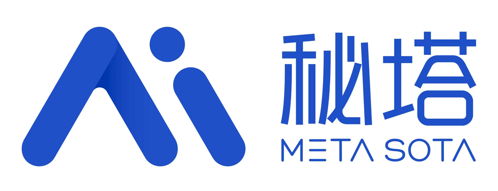</td>
      <td align="center"><b>秘塔</b></td>
      <td align="center">💻 算力赞助</td>
      <td>秘塔科技提供高性价比的 MiniMax H3 影片生成服务：<b>768P 仅 0.09 元/秒，2K 仅 0.15 元/秒</b>。支援原生 2K、音画同步，API 相容 <b>OpenAI 协议</b>，同时支援 <b>ComfyUI</b>、<b>无限画布</b>，无需自行部署 GPU。<br/><br/>🎁 透过<a href="https://metaso.cn/minimax-h3/?s=toon">专属连结注册</a>，即可领取赠送额度及专属优惠。商务对接可加微信：metasota12</td>
      <td align="center"><a href="https://metaso.cn/minimax-h3/?s=toon">官网</a></td>
    </tr>
    <tr>
      <td align="center">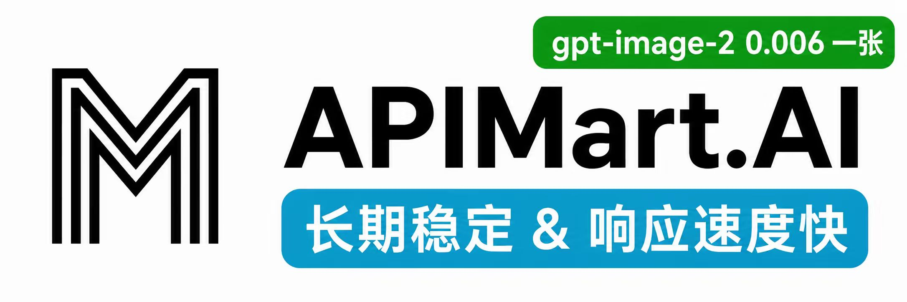</td>
      <td align="center"><b>APIMart</b></td>
      <td align="center">💻 算力赞助</td>
      <td>感谢 APIMart 赞助了本专案！APIMart 是专注于 AI 图片/影片生成的低价 API 平台，<b>GPT-Image-2 低至 $0.006/张</b>，1 美元可产出 160+ 张图片。图片、影片一套非同步 API 通吃，提交任务取得 ID、回呼取得结果，跑批万张不逾时、换模型不改程式码。按量付费、无月费，透过此<a href="https://go.apimart.ai/gh-toonflow-app">注册连结</a>注册即可开用。</td>
      <td align="center"><a href="https://go.apimart.ai/gh-toonflow-app">官网</a></td>
    </tr>
    <tr>
      <td align="center"></td>
      <td align="center"><b>算能云</b></td>
      <td align="center">💻 算力赞助</td>
      <td>致力于打造更快、更稳、更省的一站式模型推理API服务平台</td>
      <td align="center"><a href="https://www.sophnet.com/">官网</a></td>
    </tr>
    <tr>

      <td align="center"></td>
      <td align="center"><b>腾讯混元3D</b></td>
      <td align="center">🌐 世界模型技术支援</td>
      <td>腾讯混元3D AI创作引擎基于腾讯混元3D生成大模型2.5版本，业界首个一站式3D内容AI创作平台。具备文生、图生3D、3D动画生成、纹理生成等功能，支援草图生3D、3D人物生成，有低多边形模型生成优势。</td>
      <td align="center"><a href="https://3d.hunyuan.tencent.com/">官网</a></td>
    </tr>
    <tr>
      <td align="center"></td>
      <td align="center"><b>智星云</b></td>
      <td align="center">💻 算力支持 <br/> 🖼️ 镜像支持</td>
      <td>国内知名专业算力服务品牌，提供便宜稳定的算力，服务国内清北、复旦、浙大等上千所985/211高校实验室、中科院及5000余家AI企业。</td>
      <td align="center"><a href="https://www.ai-galaxy.com">官网</a></td>
    </tr>
  </tbody>
</table>

完整的第三方依赖清单请查阅 `NOTICES.txt`

##### copyright © 北京爱阿科技有限公司


